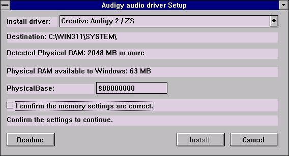
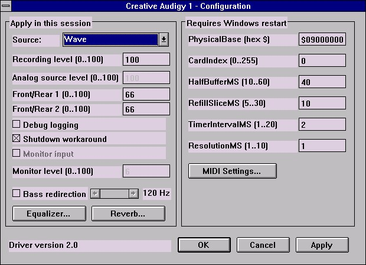
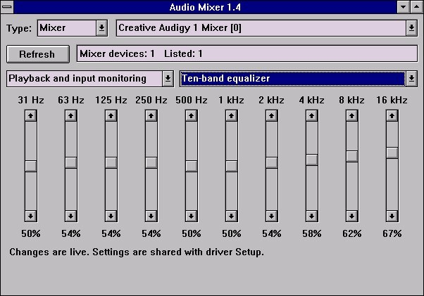
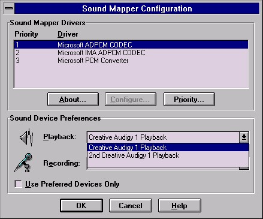
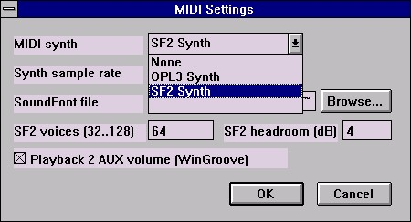

# Creative Audigy drivers for Windows 3.1x

Version **2.0** brings native WaveOut, WaveIn, mixer and MIDI support to
classic Creative Sound Blaster Audigy PCI cards in Windows 3.1x. The drivers
run in 386 Enhanced Mode and use the card directly, without a DOS audio TSR.

## Supported cards

| Card | Driver | PCI match |
| --- | --- | --- |
| Sound Blaster Audigy 1 | `AUDIGY1.DLL` | Creative `1102:0004`, revision 1–3 |
| Sound Blaster Audigy 2 / 2 ZS | `AUDIGY2.DLL` | Creative `1102:0004`, revision 4 |
| Sound Blaster Audigy 4 Pro | `AUDIGY2.DLL` | Compatible architecture, unverified on hardware |

The drivers target the EMU10K2 family. Sound Blaster Live!, Audigy LS/SE and
E-MU professional boards use different hardware and are outside this scope.

## Features

- Two independent WaveOut devices for simultaneous playback, each with its own
  stereo volume and front/rear fader. Playback accepts mono or stereo PCM at
  8 or 16 bits and 8–48 kHz.
- 16-bit mono or stereo WaveIn at 8, 11.025, 16, 22.05, 24, 32, 44.1 or 48 kHz.
  Select a physical input or record the card's playback mix before speaker
  volume, faders, EQ and reverb.
- OPL3 and SoundFont software MIDI synths with a dedicated stereo playback pair.
  The CPU renders the MIDI audio and the Audigy DSP mixes it with WaveOut.
- Hardware ten-band equalizer, Room/Chamber/Plate/Hall reverb and analog LFE
  bass redirection. The shared Audio Mixer utility also controls input
  monitoring and recording.

## Install on Windows 3.1x

Build the Win16 binaries using the [build instructions](#build-from-source) or
start with a complete binary distribution. Before running Setup, back up your
Windows configuration and configure the [physical memory reservation](#physical-memory-reservation).

1. Put `SETUP.EXE`, the driver DLL for your card, `AUDMIXER.EXE`,
   `OPLCORE.DLL`, `SFCORE.DLL` and [`README.TXT`](README.TXT) in the same directory.
   If the Windows `SYSTEM` directory lacks `MSMIXMGR.DLL`, put your copy
   beside Setup as well.
2. Run `SETUP.EXE` in Windows. Select the matching card, check the reported
   memory and `PhysicalBase`, and confirm the settings.
3. Choose **Install**, then restart Windows. Setup copies the selected driver,
   mixer and synth DLLs to the Windows `SYSTEM` directory and registers the
   WaveOut, AUX, mixer and MIDI aliases. Open **Audio Utilities → Audio Mixer**
   in Program Manager.



Setup preserves existing sound-card registrations and keeps the first
`SYSTEM.INI` backup as `AUD1INST.BAK` or `AUD2INST.BAK` in the Windows directory.
If you install both drivers, give each one its own physical RAM area and
enable the built-in synth on only one Audigy per Windows session.

For an upgrade, close audio applications and Audio Mixer, remove the old driver
in **Control Panel → Drivers**, restart Windows, and run Setup. You can also
replace the driver and synth DLLs in `SYSTEM` from DOS while keeping your
INI file. When upgrading manually from 1.5, add the MIDI alias as described in
the [manual installation instructions](README.TXT).

### Physical memory reservation

Each driver uses a **256 KiB** area of installed physical RAM for DMA buffers
and hardware effects. The area must lie above all RAM managed by DOS and
Windows and must be separate from any reservation used by HDA2 or a second
Audigy driver.

| Setting | Typical value | Purpose |
| --- | --- | --- |
| XMS provider limit | 64 MiB | Keeps the reserved region outside the memory managed by DOS and Windows |
| `PhysicalBase` | `$08000000` | Starts the driver area at 128 MiB |
| Reserved addresses at the default base | `$08000000`–`$0803FFFF` | Must be installed, unused physical RAM |

The default base requires more than 128 MiB of installed RAM. A 96 MiB
system can use a 64 MiB XMS limit and `PhysicalBase=$05000000` (80 MiB).
Check how your XMS provider defines its limit. For example, 128 MiB of XMS
starting above the first MiB extends past the default base. Setup checks the
configuration but leaves the XMS provider settings to you.

## Configure the driver and mixer

Open **Control Panel → Drivers**, select your Audigy driver and choose **Setup**.
The left column contains controls that apply in the current session. The right
column contains settings that take effect after restarting Windows, including
the MIDI configuration. The Audigy 2 driver also offers `Aud2Gain` from
0 to 12 dB in 0.25 dB steps.



For live controls, open **Audio Utilities → Audio Mixer**. Extended controls
require `MSMIXMGR.DLL`. Both WaveOut devices and the built-in synth have
independent volume and front/rear balance. A fader value of 0 selects the rear
pair, 50 sends to both, and 100 selects the front pair.



For recording, choose Line-In, Mic, analog CD, Aux, CD Digital, AudigyDrive
S/PDIF or **Wave** in Setup. Monitor lets you hear a physical input
independently of its recording level. **Wave** captures both playback devices
and the built-in synth, and disables hardware input monitoring. Some
physical sources require the corresponding internal connector or AudigyDrive.

### Two WaveOut devices

Sound Mapper lists the two independent playback devices. An application that
selects its own WaveOut device can use Playback 2 while another application
uses Playback 1. For example, configure WinGroove to use Playback 2 to give
it a separate stereo volume and front/rear fader.



## MIDI and SoundFonts

Open **MIDI Settings** from the driver Setup dialog. Select **OPL3 Synth**,
**SF2 Synth**, or **None**, and choose 44.1 kHz (default) or 48 kHz. Restart
Windows to apply the change. Both synths use the same MIDI output name on
each card, `Audigy 1 MIDI Synth` or `Audigy 2 MIDI Synth`. Select that port
in the Windows MIDI Mapper or directly in your MIDI player.



- **OPL3 Synth** uses `OPLCORE.DLL` and has no external instrument bank.
- **SF2 Synth** uses `SFCORE.DLL`. Choose your own PCM16 SoundFont file.
  The default filename is `4GMGSMT.SF2`, and relative paths resolve from
  the Windows `SYSTEM` directory. The loader requires an x87 FPU and locks
  the samples in Windows-managed memory. Playback uses fixed-point arithmetic.
- **SF2 voices** defaults to 64 and accepts 32–128 sample voices. Layered
  and stereo presets may use more than one voice per note. **SF2 headroom**
  defaults to 3 dB and accepts 0–24 dB.
- **Playback 2 AUX volume** exposes a separate AUX volume control for the
  second WaveOut device. This lets compatible MIDI players adjust the
  output of WinGroove when it uses Playback 2.

SoundFont modulators and per-channel chorus/reverb sends are outside the
current SF2 implementation. The Audigy hardware reverb is available to both
synths. Both also retry playback after repeated PCM starvation, which can
occur during disk activity on PIO systems.

### Tested SoundFonts

The SF2 synth is based on [TinySoundFont](SFCORE/TSF16.H) and supports a
subset of SoundFont features. I tested it extensively with these two banks:

1. **Reality_GMGS_falcomod.sf2** is about 32 MB. I recommend it for systems
   with at least 64 MB of RAM available to Windows 3.1x.
   [Download Reality GMGS FalcoMod](https://falcosoft.hu/reality_gmgs_falcomod.zip).
2. **Creative's 4GMGSMT.SF2** is only 4 MB. It includes GS and MT-32
   variation tones and sounds quite good for its size.

## Build from source

### Drivers, installer and mixer

Open each project in **Borland Delphi 1** and use **Build All**.

| Project | Output |
| --- | --- |
| [`AUDIGY1/AUDIGY1.DPR`](AUDIGY1/AUDIGY1.DPR) | `AUDIGY1.DLL` |
| [`AUDIGY2/AUDIGY2.DPR`](AUDIGY2/AUDIGY2.DPR) | `AUDIGY2.DLL` |
| [`SETUP/SETUP.DPR`](SETUP/SETUP.DPR) | `SETUP.EXE` |
| [`MIXER/AUDMIXER.DPR`](MIXER/AUDMIXER.DPR) | `AUDMIXER.EXE` |

The source tree includes the Win16 resources and forms. Setup and Audio Mixer
are shared between both drivers.

### Synth cores

Use **Open Watcom 2.0** with the 16-bit x86 Windows target. Install the Win16
headers, the libraries under `LIB286` and `LIB286\WIN`, and WLINK's Windows
DLL target definitions. Put `WCC`, `WPP` (needed for OPL3), and `WLINK` on
`PATH`, with `WATCOM` pointing to the installation root.

From the repository root in a DOS/Windows command prompt with the Watcom
environment initialized, run the following.

```bat
SET INCLUDE=%WATCOM%\h;%WATCOM%\h\win
CD FMCORE
BUILD.BAT
CD ..\SFCORE
BUILD.BAT
CD ..
```

Copy `FMCORE\OPLCORE.DLL` and `SFCORE\SFCORE.DLL` to the installation package
with the Delphi binaries. Python 3 is needed only to regenerate the
included `SFTABLE.H` with `SFCORE\MKTABLES.PY`.

## Troubleshooting

- For a startup failure, try `MidiSynth=0` under `[AUDIGY1]` or `[AUDIGY2]`
  in the corresponding INI file in the Windows directory. This disables
  the built-in MIDI synth for the next Windows session.
- For SF2 loading failures, check the bank path and available Windows-managed
  memory. The memory reserved at `PhysicalBase` is separate from the memory
  available for locking SoundFont samples.
- For timing or playback problems, set `Debug=1`, reproduce the problem, then
  close the audio application and exit Windows normally. Save `AUDIGY1.LOG`
  or `AUDIGY2.LOG` from the Windows directory before restarting. The driver
  clears it on each load.

See [`README.TXT`](README.TXT) for manual installation, the INI reference and
the full changelog. The Win16 installer's **Readme** button opens that file.

## License and credits

The project-authored driver code is available under the
[GNU General Public License, version 2](LICENSE). Existing third-party
copyright and license notices apply to the corresponding components,
including [the OPL3 core](FMCORE/UPSTREAM.TXT),
[TinySoundFont](SFCORE/TSF16.H), and the
[installer](SETUP/SOURCE.TXT). See the
[Audigy 1](AUDIGY1/SOURCES.TXT) and [Audigy 2](AUDIGY2/SOURCES.TXT)
source notes for hardware and implementation credits. The LMP ZIPs
mentioned in the Audigy 2 notes are historical reference archives.

`MSMIXMGR.DLL` and SoundFont banks are supplied separately.

Maintained by Zoltán Bacskó (Falcosoft).
